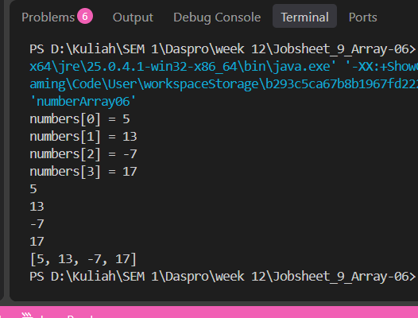
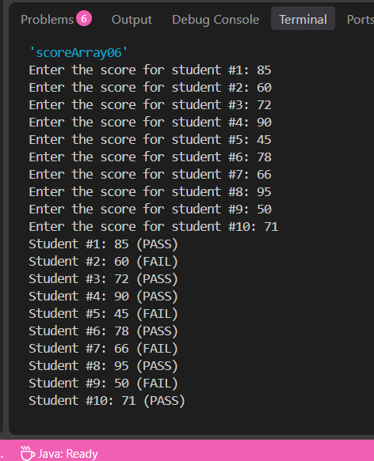
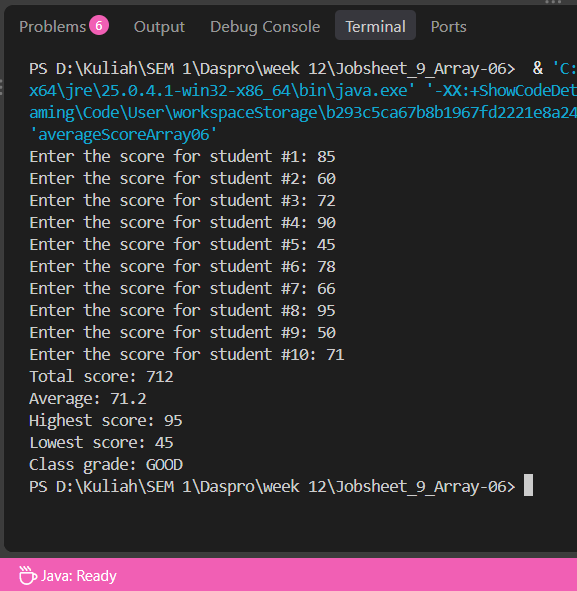
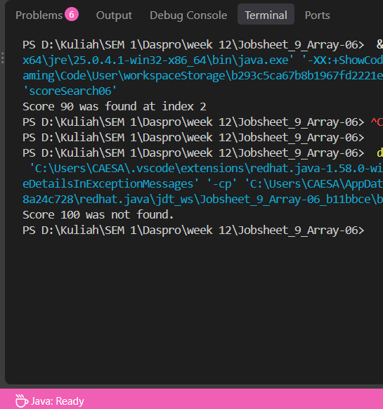
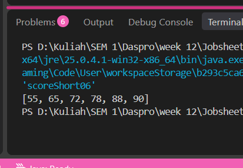
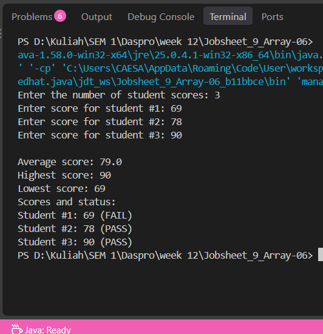
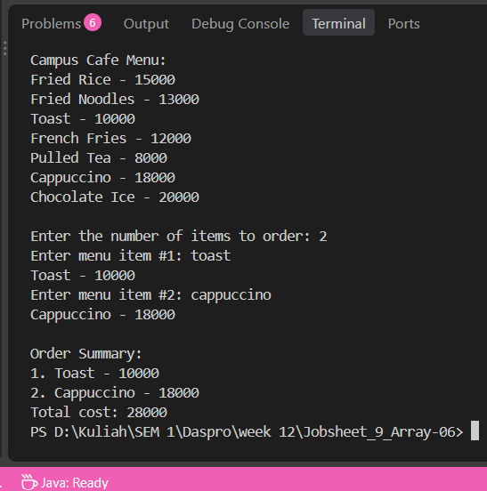

# JOBSHEET 9 - ARRAY 1

**Identitas Mahasiswa:**
* **Nama:** Datu Ayu Fitria Ceasa
* **NIM:** 264107020087
* **Kelas / No. Presensi:** 1I / 06

---

## 1: OBJECTIVES

1. Students are able to understand the concept of one-dimensional arrays and how to declare, initialize, and access their elements in the Java programming language.
2. Students are able to write programs that use one-dimensional arrays to store and process data, including the use of for and foreach loops.
3. Students are able to apply arithmetic operations to array elements, such as calculating the total, average, highest value, and lowest value.
4. Students are able to apply simple searching and sorting algorithms to one-dimensional arrays.
5. Students are able to apply one-dimensional arrays to solve case studies that are relevant to campus life and everyday situations.  

---

## 3: Lab Exercises

### 3.1. Experiment 1: Declaring, Initializing, Filling, and Displaying Array Elements
#### 3.1.1 Java Code
```java
import java.util.Arrays;

public class numberArray06 {
    public static void main(String[] args) {
        int[] numbers = new int[4];
        numbers[0] = 5; 
        numbers[1] = 13; 
        numbers[2] = -7; 
        numbers[3] = 17; 

        for (int i = 0; i < numbers.length; i++) { 
            System.out.println("numbers[" + i + "] = " + numbers[i]); 
        } 

        for (int number : numbers) { 
            System.out.println(number); 
        }

        System.out.println(Arrays.toString(numbers));
    }
}
```

#### 3.1.2 Screenshot Output



#### 3.1.3 Questions
* **Question 1:** If the elements of the numbers array are changed to 5.0, 12867, 7.5, 2000000, what happens? Why does this happen?
   * **Answer:** The program will not compile if numbers is still an int[] and you assign 5.0 or 7.5. Those are double literals, and Java does not automatically narrow them to integers because that could lose the fractional part. The other values, 12867 and 2000000, are valid int values. If you need to keep the decimal values, declare the array as double[]; Java will convert the integer values to doubles as well.
* **Question 2:** Modify the program above by initializing the array elements at the same time the array is declared (without new int[4] and without filling the elements one by one).  
  * **Answer:**
    ```
    import java.util.Arrays;

    public class numberArray06 {
        public static void main(String[] args) {
            int[] numbers = {5, 13, -7, 17};

            for (int i = 0; i < numbers.length; i++) {
                System.out.println("numbers[" + i + "] = " + numbers[i]);
            }

            for (int number : numbers) {
                System.out.println(number);
            }

            System.out.println(Arrays.toString(numbers));
        }
    }
    ```
* **Question 3:** Change the display statement in step 4 to the following: System.out.println("numbers[" + i + "] = " + numbers[i] + ", doubled = " + (numbers[i] * 2)); What is the output of the program? Explain the meaning of the statement.
  * **Answer:**
    **numbers[0] = 5, doubled = 10**
    **numbers[1] = 13, doubled = 26**
    **numbers[2] = -7, doubled = -14**
    **numbers[3] = 17, doubled = 34**
    
* **Question 4:** If the condition in the for loop above is changed to i <= 4, what is the output of the program? Why?   
  * **Answer:**
* **Question 5:** What is the difference between displaying an array using a for loop, a foreach loop, and Arrays.toString() in step 5? When should each one be used? 
  * **Answer:**


---

### 3.2. Experiment 2: SIAKAD Case Study — Entering Student Scores and Pass/Fail Status 
#### 3.2.1 Java Code
```java
import java.util.Scanner;

public class scoreArray06 {
    public static void main(String[] args) {
        int[] finalScores = new int[10]; 
        Scanner input = new Scanner(System.in);
        
        for (int i = 0; i < finalScores.length; i++) { 
            System.out.print("Enter the score for student #" + (i + 1) + ": "); 
            finalScores[i] = input.nextInt(); 
        } 

        for (int i = 0; i < finalScores.length; i++) { 
            String status = (finalScores[i] > 70) ? "PASS" : "FAIL"; 
            System.out.println("Student #" + (i + 1) + ": " + finalScores[i] + " (" + status + ")"); 
        } 
    }
}
```



#### 3.2.3 Questions
* **Question 1:** What does the condition i < finalScores.length in the loop above mean?
  * **Answer:**
    The syntax if (score < 0 || score > 100) { System.out.println("Invalid score. Please enter a valid score!"); continue; } means: if the score is less than 0 or greater than 100, it is invalid, so the program prints an error message and immediately skips the rest of the current loop iteration using continue. Its purpose is to prevent 
* **Question 2:** Modify the program so that it displays only the scores of students who passed (score > 70), without displaying those who failed. Explain the flow of the program!
  * **Answer:**
    The i++ statement is written at the end of the while loop so that each time a valid student score is entered and processed, the counter increases by 1. This keeps track of how many students have already been handled and ensures the loop eventually stops when i reaches studentCount. If i++ were written at the beginning of the loop, the loop would skip the first student because i would increase before checking or processing the score, causing the program to count incorrectly and possibly stop too early.
* **Question 3:** Change the loops in steps 4 and 5 from for loops to foreach loops. Can all parts of the program be converted to foreach? Explain which parts can and cannot be converted, along with the reasons.  
  * **Answer:**
    If the number of students entered is 19, the while loop will run 19 times, because the loop condition is while (i < studentCount), so it repeats until i reaches 19. Each valid student input increases i by 1, and the loop stops when i becomes 19.
* **Question 4:** Modify the program so that it also calculates and displays the number of students who passed and 
the number of students who failed at the end of the program. 
  * **Answer:**
    

### 3.3. Experiment 3: Arithmetic Operations on Arrays — Total, Average, Highest and Lowest Scores

#### 3.3.1 Java Code
```java
import java.util.Scanner;

public class averageScoreArray06 {
    public static void main(String[] args) {
        Scanner input = new Scanner(System.in);
        int[] studentScores = new int[10]; 
        int total = 0; 
        double average;

        for (int i = 0; i < studentScores.length; i++) { 
            System.out.print("Enter the score for student #" + (i + 1) + ": "); 
            studentScores[i] = input.nextInt(); 
            total += studentScores[i]; 
        }

        average = (double) total / studentScores.length; 
        System.out.println("Total score: " + total); 
        System.out.println("Average: " + average);
        
        int highest = studentScores[0]; 
        int lowest = studentScores[0]; 
        for (int i = 1; i < studentScores.length; i++) { 
            if (studentScores[i] > highest) highest = studentScores[i]; 
            if (studentScores[i] < lowest) lowest = studentScores[i]; 
        } 

        System.out.println("Highest score: " + highest); 
        System.out.println("Lowest score: " + lowest);
        
        int classGrade;
        if ((int) average >= 85) {
             System.out.println("Class grade: EXCELLENT ");
        } else if ((int) average >= 70) {
             System.out.println("Class grade: GOOD ");
        } else {
             System.out.println("Class grade: NEEDS IMPROVEMENT ");
        }
    }
}
```

#### 3.3.2 Screenshot Output



#### 3.3.3 Questions
* **Question 1:** Modify the code above so that it displays the number of students who passed, that is, students whose score is greater than 70 (> 70). 
  * **Answer:** The loop runs once. A do-while loop executes its body before checking the condition. Since the first name is “cancel,” the break statement exits the loop during that first execution.
* **Question 2:** Modify the program above so that it accepts the number of array elements from user input (not always 10), while still calculating the total, average, highest value, and lowest value correctly.  
  * **Answer:** The loop’s condition is while (true), which is always true. In practice, the loop stops when the customer enters “cancel” and the break statement runs.
* **Question 3:** Why is (double) total / studentScores.length used in the average calculation instead of simply total / studentScores.length? Explain!  
  * **Answer:** true makes the loop repeat indefinitely unless it is exited another way, such as with the break statement.

### 3.4. Experiment 4: Simple Searching and Sorting

#### 3.4.1 Part A — Linear Search
#### Java Code
```java
public class scoreSearch06 {
    public static void main(String[] args) {
        int[] scores = {78, 65, 90, 55, 88, 72}; 
        int key = 90; 
        boolean found = false; 
        for (int i = 0; i < scores.length; i++) { 
            if (scores[i] == key) { 
                System.out.println("Score " + key + " was found at index " + i); 
                found = true; 
                break; 
            } 
        } 
        if (!found) { 
            System.out.println("Score " + key + " was not found."); 
        }
    }
}
```

#### Screenshot Output



#### 3.4.2 Part B — Bubble Sort 
#### Java Code
```java
import java.util.Arrays;

public class scoreShort06 {
    public static void main(String[] args) {
        int[] scores = {78, 65, 90, 55, 88, 72};

        for (int i = 0; i < scores.length - 1; i++) {
            for (int j = 0; j < scores.length - 1 - i; j++) {
                if (scores[j] > scores[j + 1]) {
                    int temp = scores[j];
                    scores[j] = scores[j + 1];
                    scores[j + 1] = temp;
                }
            }
        }

        System.out.println(Arrays.toString(scores));
    }
}
```

#### Screenshot Output



#### 3.4.3 Questions
* **Question 1:** Explain the meaning of the break; statement in the Part A code above!  
  * **Answer:** The loop runs once. A do-while loop executes its body before checking the condition. Since the first name is “cancel,” the break statement exits the loop during that first execution.
* **Question 2:** Modify the Part A code so that the program accepts, as user input, the number of elements in the scores array, the array contents, and a value (key) to search for, and then prints the index position of 
that value (key) in the array. 
  * **Answer:** The loop’s condition is while (true), which is always true. In practice, the loop stops when the customer enters “cancel” and the break statement runs.
* **Question 3:** Modify the Part A program so that it displays the message "The value you are looking for was not found" in a more informative format when the value being searched for (key) does not exist in the array.   
  * **Answer:** true makes the loop repeat indefinitely unless it is exited another way, such as with the break statement.
* **Question 4:** Explain step by step how the bubble sort algorithm in Part B works, using the test data provided!    
  * **Answer:** true makes the loop repeat indefinitely unless it is exited another way, such as with the break statement.
* **Question 5:** Modify the Part B program so that it sorts the array from the largest to the smallest value (descending), instead of from the smallest to the largest.   
  * **Answer:** true makes the loop repeat indefinitely unless it is exited another way, such as with the break statement.

---

## 4: Assignment 

The following is a list of tasks performed on this Jobsheet:

- [x] **Task 1:** Write a program that can store and manage student scores (integers). The program must provide features to:
      
• Enter the number of student scores to be input. 

• Enter each student score one by one. 

• Calculate the average of all of the scores entered. 

• Display the highest and lowest scores. 

• Display all of the scores entered, along with their pass/fail status (PASS / FAIL).
      
- [x] **Task 2:** Write a program that can manage food and beverage orders at a campus café. The program provides a predefined menu list, allows users to select menu items through a search feature, records orders, and calculates the total cost. 
Café menu list (initialize an array of String at declaration):
```
String[] menu = {"Fried Rice", "Fried Noodles", "Toast", "French Fries", "Pulled 
Tea", "Cappuccino", "Chocolate Ice"}; 
int[] prices = {15000, 13000, 10000, 12000, 8000, 18000, 20000};
```

The program you write must meet the following requirements: 

• Menu search feature: the user enters the name of the food or beverage they want to order, and the program searches for that name in the menu array using the linear search algorithm. If it is found, display its price; if it is not found, inform the user that the menu item is not available. 

• Ordering feature: the user enters the number of items to order, then for each item selects a menu name (which must be validated to ensure it exists in the menu list). Store the names of the ordered items in a one-dimensional array that is separate from the main menu array. 

• Calculate and display the total cost of all of the orders entered by the user. 

• Display the list of orders that have been made, along with the total cost, in a neat and easy-to-read format. 

### 4.1 Task 1 Code Implementation

```java
import java.util.Scanner;

public class managingScore06 {
    public static void main(String[] args) {
        Scanner input = new Scanner(System.in);

        System.out.print("Enter the number of student scores: ");
        int count = input.nextInt();

        if (count <= 0) {
            System.out.println("The number of scores must be greater than 0.");
            input.close();
            return;
        }

        int[] scores = new int[count];
        long total = 0;

        for (int i = 0; i < scores.length; i++) {
            System.out.print("Enter score for student #" + (i + 1) + ": ");
            scores[i] = input.nextInt();
            total += scores[i];
        }

        int highest = scores[0];
        int lowest = scores[0];

        for (int score : scores) {
            if (score > highest) {
                highest = score;
            }
            if (score < lowest) {
                lowest = score;
            }
        }
        
        double average = (double) total / scores.length;

        System.out.println("\nAverage score: " + average);
        System.out.println("Highest score: " + highest);
        System.out.println("Lowest score: " + lowest);
        System.out.println("Scores and status:");

        for (int i = 0; i < scores.length; i++) {
            String status = scores[i] > 70 ? "PASS" : "FAIL";
            System.out.println("Student #" + (i + 1) + ": " + scores[i] + " (" + status + ")");
        }
    }
}
```


### 4.2 Task 2 Code Implementation
```java
import java.util.Scanner;

public class campusCafeApp {
    public static void main(String[] args) {
        Scanner input = new Scanner(System.in);

        String[] menu = {
            "Fried Rice", "Fried Noodles", "Toast", "French Fries",
            "Pulled Tea", "Cappuccino", "Chocolate Ice"
        };
        int[] prices = {15000, 13000, 10000, 12000, 8000, 18000, 20000};

        System.out.println("Campus Cafe Menu:");
        for (int i = 0; i < menu.length; i++) {
            System.out.println(menu[i] + " - " + prices[i]);
        }

        System.out.print("\nEnter the number of items to order: ");
        int itemCount = input.nextInt();
        input.nextLine();

        if (itemCount <= 0) {
            System.out.println("The number of items must be greater than 0.");
            input.close();
            return;
        }

        String[] orders = new String[itemCount];
        int totalCost = 0;

        for (int i = 0; i < orders.length; i++) {
            while (true) {
                System.out.print("Enter menu item #" + (i + 1) + ": ");
                String itemName = input.nextLine().trim();
                int menuIndex = findMenuItem(menu, itemName);

                if (menuIndex != -1) {
                    orders[i] = menu[menuIndex];
                    totalCost += prices[menuIndex];
                    System.out.println(orders[i] + " - " + prices[menuIndex]);
                    break;
                }

                System.out.println("That menu item is not available. Please try again.");
            }
        }

        System.out.println("\nOrder Summary:");
        for (int i = 0; i < orders.length; i++) {
            int menuIndex = findMenuItem(menu, orders[i]);
            System.out.println((i + 1) + ". " + orders[i] + " - " + prices[menuIndex]);
        }
        System.out.println("Total cost: " + totalCost);

        input.close();
    }

    private static int findMenuItem(String[] menu, String itemName) {
        for (int i = 0; i < menu.length; i++) {
            if (menu[i].equalsIgnoreCase(itemName)) {
                return i;
            }
        }
        return -1;
    }
}
```


---

## 4: Conclusion

These programs demonstrate how loops and conditional statements
